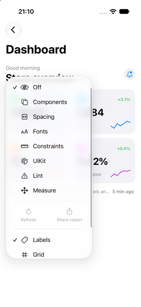
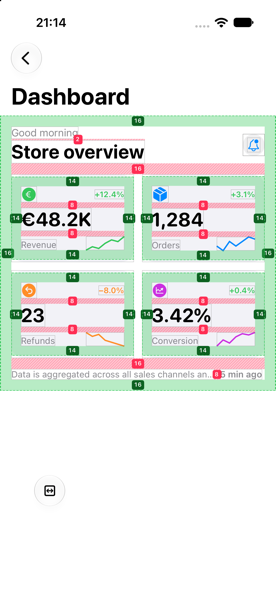
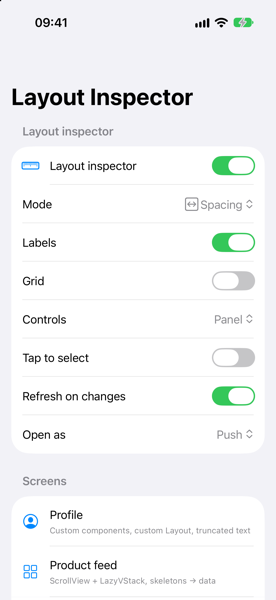

# SwiftUI Layout Inspector

A runtime layout inspector for SwiftUI screens. Attach one modifier to a screen and see what SwiftUI actually
laid out: component bounds and sizes, measured paddings and gaps (including the real default spacing),
fonts and line heights, `.frame` / `fixedSize` / `layoutPriority`, Auto Layout of embedded UIKit views,
design-rule violations and distances between elements.

The inspected view is not changed. The overlay and the controls live in a separate window above the app,
and the data comes from the SwiftUI runtime — the same debug graph Xcode's view debugger reads.

<table>
  <tr>
    <td></td>
    <td></td>
    <td></td>
    <td></td>
    <td></td>
  </tr>
  <tr>
    <td>Spacing, sheet</td>
    <td>The menu</td>
    <td>Lint, push</td>
    <td>Spacing and the control button</td>
    <td><code>LayoutInspectorSettings</code></td>
  </tr>
</table>

## Requirements

- iOS 17+. On macOS the package compiles and does nothing, so shared code can keep its modifiers.
- Xcode 26+ (Swift tools 6.2).
- Debug builds only — see [Private API](#private-api).

## Installation

```swift
// Package.swift
.package(url: "https://github.com/adurymanov/SwiftUILayoutInspector.git", from: "0.2.5"),

.target(name: "App", dependencies: [
    .product(name: "LayoutInspector", package: "SwiftUILayoutInspector"),
]),
```

In Xcode: *File → Add Package Dependencies…* with the same URL.

## Quick start

1. Enable recording of the SwiftUI debug graph once, before the app's first SwiftUI view is created:

   ```swift
   import LayoutInspector

   @main struct MyApp: App {
       init() {
           LayoutInspector.bootstrap()
       }
       var body: some Scene { WindowGroup { RootView() } }
   }
   ```

   `bootstrap()` sets the environment variable `SWIFTUI_VIEW_DEBUG=27` and the master switch
   `LayoutInspector.isEnabled` — nothing else: no swizzling, no windows, no observers. SwiftUI reads the
   variable **once per process**, when it creates its first view graph, and from then on records a debug tree
   for every view. So the call has to come before the first SwiftUI view of the app, not just before the
   inspected screen: `App.init`, or `application(_:willFinishLaunchingWithOptions:)` before the first
   `UIHostingController`. A later call is detected: it logs a warning and
   `LayoutInspector.isSwiftUIGraphRecordingEnabled` stays `false`.

   Without the graph the inspector still works, but only sees the UIKit render tree (no component names, no
   paddings or fonts). Setting `SWIFTUI_VIEW_DEBUG=27` in the scheme does the same as `bootstrap()`.
   [Xcode previews](#xcode-previews) don't need it.

2. Attach the inspector to a screen:

   ```swift
   ProfileScreen()
       .layoutInspector(.spacing)
   ```

The overlay covers exactly that view and follows it: scrolling, data loading, navigation and sheet
transitions. It works the same for pushed screens, sheets and full-screen covers. Taps go to the screen
unless tap selection is on.

## Configuration

Everything the inspector shows is described by one value, `LayoutInspector.Configuration`:

| property | default | |
|---|---|---|
| `isEnabled` | `true` | `false` — no overlay, no window, no capturing |
| `mode` | `.components` | which overlay to draw, see [Modes](#modes) |
| `showsLabels` | `true` | names, sizes and values next to the outlines |
| `showsGrid`, `gridSize` | `false`, `8` | square grid over the view |
| `toolbar` | `.visible` | `.visible` round glass button (drag it anywhere, tap for the menu), `.hidden` |
| `selectsOnTap` | `false` | taps select elements (outlined in the overlay) instead of reaching the screen (always on in `.measure`) |
| `autoRefresh` | `true` | re-capture when the content changes; scrolling is followed either way |
| `lintRules` | see below | design rules checked in `.lint` |

It is `Codable`, `Hashable` and `Sendable`: keep it in your own state and persist it however you persist
settings. Unknown or missing keys fall back to defaults when decoding.

### Three ways to attach

```swift
// Fixed mode, optionally switched on and off.
ScreenView()
    .layoutInspector(.typography, isEnabled: showsLayout)

// A configuration value. Changes made from the inspector's toolbar stay local
// and are replaced when the value changes.
ScreenView()
    .layoutInspector(LayoutInspector.Configuration(mode: .lint, toolbar: .hidden))

// A binding: change it to reconfigure the inspector at runtime; switching the mode,
// toggling labels or closing the inspector from its toolbar writes back.
@State private var inspector = LayoutInspector.Configuration(mode: .spacing)

ScreenView()
    .layoutInspector($inspector)
```

Toggling `isEnabled` keeps the identity of the inspected view, so its state is never reset.

### Settings rows

`LayoutInspectorSettings` edits a configuration. Put it into your own `Form` or `List`, next to the other
settings of the screen you are about to open:

```swift
Form {
    Section("Layout") {
        LayoutInspectorSettings($inspector)
    }
}
```

### Lint rules

```swift
var configuration = LayoutInspector.Configuration(mode: .lint)
configuration.lintRules = LayoutInspector.LintRules(
    grid: 4,                                  // paddings and spacings must be multiples of 4
    typeScale: [12, 14, 16, 20, 24, 32],      // allowed fixed font sizes
    warnOnFixedSizeFonts: true,               // fonts that ignore Dynamic Type
    minTapTarget: 44,                         // buttons and navigation links
    alignmentTolerance: 2                     // "almost aligned" children of leading/trailing stacks
)
```

Repeated issues (rows of a `ForEach`) are merged into one line with a counter.

## Modes

| mode | shows |
|---|---|
| `.components` | app-defined views with their type name and size, stacks (spacing, alignment), custom `Layout`s, controls, scroll views and lists |
| `.spacing` | measured paddings, gaps between stack children including the real default spacing (`8 auto`), system list insets, `UIStackView` spacing |
| `.typography` | text style or fixed font, size, weight, line height, line count, color, baseline; truncated text in red; UIKit labels and text fields too |
| `.constraints` | `.frame` (fixed, min/max/ideal, `∞` as arrows), `fixedSize`, `layoutPriority`, `aspectRatio`, spacers, stack alignment guides, Auto Layout of UIKit views |
| `.uikit` | the render tree: views and layers SwiftUI draws into, UIKit fonts and constraints |
| `.lint` | numbered design-rule violations and their list |
| `.measure` | distance between two tapped elements, or from one element to its container |

The controls are a round glass button (a material before iOS 26) that can be dragged anywhere; it remembers
its place. A tap opens the menu: the modes, Refresh, Share report (a text layout report), Labels, Grid and
Close. With `highlightsOnAppear: false` a screen is not captured until a mode is picked there, so nothing is
computed while navigating; the button shows the capture's progress.

## Turning it off

- **One view:** `isEnabled: false` or `configuration.isEnabled = false`. Nothing is captured or drawn.
- **The whole app:** `LayoutInspector.bootstrap(isEnabled: false)` at launch keeps SwiftUI untouched and
  makes every modifier inert; `LayoutInspector.isEnabled` switches all inspectors off and on at runtime.
- **The build:** the package trait `LayoutInspectorEngine` (enabled by default) compiles the inspector in.
  Without it every API is still there but does nothing, and the binary contains no references to private
  API:

  ```swift
  .package(url: "https://github.com/adurymanov/SwiftUILayoutInspector.git", from: "0.2.5", traits: []),
  ```

  Package traits apply to every build configuration. To keep the inspector in Debug and drop it from Release,
  set the compilation condition `LAYOUT_INSPECTOR_DISABLED` for the `LayoutInspector` target in the
  configurations that ship (for example through Tuist's `PackageSettings` or an `.xcconfig`). It compiles the
  engine out the same way a missing trait does.

  `LayoutInspector.isAvailable` tells at runtime whether the inspector is compiled in.

Only one inspector is on screen at a time: the most recently shown one. A screen with an inspector that
presents another screen with an inspector hands over to it and takes over again when it is dismissed.
While a sheet or an alert without an inspector covers the inspected view, the inspector hides.

## Inspecting the whole window

Without touching any view — from a debug menu or a shake gesture. The inspector follows the window in front
(the one that takes a touch in the middle of the screen), so a debug menu, sheet or popup an app shows in a
window of its own is inspected too. What a full-screen cover or an opaque sheet hides in the same window is not
marked:

```swift
LayoutInspector.show(.init(mode: .components))
LayoutInspector.hide()
LayoutInspector.isVisible
```

## Layout in tests

The same data is available without the overlay — handy for assertions that don't depend on pixels:

```swift
let layout = try await LayoutInspector.captureWhenStable(window)   // waits for data and animations

let header = try XCTUnwrap(layout.find("ProfileHeader", kind: .component))
let row = try XCTUnwrap(header.descendants(.stack).first { $0.stack?.axis == .horizontal })
XCTAssertEqual(row.measuredGaps.first, 14)
XCTAssertEqual(layout.find("Anna Petrova", kind: .text)?.font?.displayName, "Title 2 22pt Bold")
XCTAssertEqual(layout.nodes(.text).first { $0.text?.isTruncated == true }?.enclosingComponent?.title, "BioSection")
XCTAssertTrue(layout.lintIssues(rules: myRules).isEmpty)

// A stable text "layout snapshot", good for swift-snapshot-testing's `.lines`
assertSnapshot(of: layout.report(), as: .lines)

// The screen with an overlay as an image
let image = InspectorImageRenderer.image(of: window, capture: layout, options: InspectorRenderOptions(mode: .spacing))
```

`captureWhenStable` waits until nothing moves for `quietPeriod` and no `ProgressView` is visible (or until
your own `until:` condition holds) and throws `CaptureTimeoutError` otherwise. `LayoutInspector.capture(_:)`
captures immediately.

## Xcode previews

```swift
#Preview {
    ProfileScreen()
        .layoutInspector(.spacing)
}
```

No `bootstrap()` is needed. Xcode runs previews in processes marked with `XCODE_RUNNING_FOR_PREVIEWS=1`, and in
such a process the library sets `SWIFTUI_VIEW_DEBUG` itself when it is loaded, before SwiftUI creates a view.
This also covers screens in packages and frameworks, whose previews are hosted by Xcode's own app where no
`App.init` runs. Nothing changes outside of previews.

The first capture in a fresh preview process is slow — 1.5–4 s while the Swift runtime warms up — so the
overlay shows up a moment after the screen. Xcode's own snapshot of a preview (Xcode MCP's `RenderPreview`)
is taken earlier and shows the button with the capture's progress. To get the numbers or a picture without the
canvas, run code instead.

## Coding agents and Xcode MCP

Xcode's MCP tool `RunCodeSnippet` runs code in the context of a source file, in the same kind of process as
previews. An agent can inspect any screen of a target that links the library this way, without changing the
project and without the modifier:

```swift
// RunCodeSnippet, sourceFilePath: the file that declares ProfileScreen
let window = UIWindow(frame: CGRect(x: 0, y: 0, width: 402, height: 874))
window.rootViewController = UIHostingController(rootView: ProfileScreen())
window.isHidden = false
window.layoutIfNeeded()

let layout = LayoutInspector.capture(window)
print(layout.report())
print(layout.lintIssues().map(\.message).joined(separator: "\n"))

// The screen with an overlay, for agents that read images
let image = InspectorImageRenderer.image(of: window, capture: layout, options: InspectorRenderOptions(mode: .spacing))
try image.pngData()!.write(to: URL(fileURLWithPath: "/tmp/ProfileScreen-spacing.png"))
```

```
# Layout report – SwiftUI graph

## _UIHostingView
ProfileScreen  [@ 0,0 402×874]
  .frame (maxHeight: .infinity, alignment: .top)  [@ 0,0 402×874]
    .padding (24)  [measured 24 | @ 0,0 402×200.67]
      VStack spacing 16 · .leading  [gaps 16 | @ 24,24 354×152.67]
        Text “Profile”  [Large Title 34pt Bold | #000000 | @ 24,24 102.33×48.67]
        …
```

The snippet's window has no scene: no safe area, no status bar. Give screens that load data the same
fixtures as their previews.

## How it works

1. **SwiftUI debug graph.** With `SWIFTUI_VIEW_DEBUG` set, every hosting view (screens, navigation
   destinations, list cells) records its view tree with values: padding insets, frame constraints,
   stack spacing and alignment, resolved text attributes, positions and sizes. The inspector reads it
   through `_viewDebugData()` (the data behind Xcode's `makeViewDebugData`) without SwiftUI's JSON: it has
   SwiftUI encode only the values it uses, and turns the tree into a compact semantic tree. Positions are
   followed through `.offset`, scale and rotation effects, geometry and drawing groups, Liquid Glass and an app's
   own `GeometryEffect`, so markup lands where the element is drawn.
2. **AttributeGraph.** The debug graph drops app-defined views that SwiftUI builds as view lists (most views
   inside stacks) and custom `Layout`s. They are restored from AttributeGraph's tree elements by matching
   the chain of types their `body` resolves to.
3. **UIKit render tree.** Layers SwiftUI draws into, UIKit controls, `UIViewRepresentable`s with their Auto
   Layout constraints. Works without any setup.

Captures are cached per hosting view and repeated when the render tree changes and settles. Everything runs
on the main thread, a few steps per frame, so the app and the button's progress ring keep moving during a
capture. The first capture of new content is the slowest: the Swift runtime looks up protocol conformances of
types it has not seen yet, and in a large app each lookup scans tens of thousands of records. The home screen of
a large banking app (12 hosting views) takes about 1.2 s on the simulator, with no step longer than 80 ms;
later captures take milliseconds.

## Performance

Measured with `Example/InspectorBenchmark` on an iPad Pro 11" (M2, iOS 27.0), Release build: 6 runs with and
6 runs without `SWIFTUI_VIEW_DEBUG` in alternating order, medians.

**`bootstrap()` with the inspector closed** — what recording the debug graph costs the app's own SwiftUI work:

| | without | with |
|---|---|---|
| first mount, 100-row list | 148.6 ms | 149.1 ms |
| mount again, 100-row list | 98.6 ms | 99.3 ms |
| first mount, 48-row `Form` | 132.9 ms | 133.5 ms |
| mount again, `Form` | 87.4 ms | 88.0 ms |
| update all 100 rows | 29.5 ms | 29.6 ms |
| update one row | 2.1 ms | 2.1 ms |
| 150 scroll steps through a 2000-row `LazyVStack` | 439 ms | 442 ms |
| memory after all of the above | 45.1 MB | 45.6 MB |

The difference stays within 1%, mostly within the run-to-run spread.

**The inspector open** — one capture, measured with 0.2.1: the first one in the process takes 1.2 s (the Swift
runtime warms up), the first capture of the next new screen 0.42 s, repeated captures 15–16 ms. Since 0.2.3
captures no longer go through SwiftUI's JSON: on the simulator the demo screens take 3–4 times less, and the
home screen of a large app 1.2 s instead of 21 s. 0.2.4 added component names that cost such a screen another 3–4 s;
0.2.5 brings it back to 1.3 s with the same names.

These are main-thread times for building, layout and committing layers; the render server and the GPU are not
included. The content is synthetic, and other devices were not measured. The per-frame cost of an open inspector
(following scrolling and content changes) is not measured either.

To repeat: run the `InspectorBenchmark` scheme once from Xcode to install it (it uses the Release configuration;
pick your team to run it on a device), then

```bash
cd Example/InspectorBenchmark
./run.sh <simulator-or-device-udid> 6 results.jsonl   # devices must be unlocked
python3 report.py results.jsonl
```

Raw results are in `Example/InspectorBenchmark/Results/`.

## Private API

The inspector relies on SwiftUI and AttributeGraph internals: the `makeViewDebugData` selector,
`_viewDebugData()` and the layout of `_ViewDebug.Data`, AttributeGraph's tree-element and type-description C
functions (looked up with `dlsym`) and the memory layout of `ViewGraph`. Each level degrades on its own: with an
unknown `_ViewDebug.Data` layout the data is read through its public `Encodable` conformance (slower, same
result), without AttributeGraph there are no component names, without the debug graph only the render tree
remains.

- Ship it in debug or internal builds only. For App Store builds, remove the dependency or compile the
  inspector out with `traits: []`.
- Verified on iOS 27.0, 26.5, 18.0 and 17.5 simulators (Xcode 27). Other versions may lose some details.
- Component matching is heuristic. `Toggle`, `TextField` and `Picker` are recognised by their UIKit parts;
  content under `scaleEffect` and `rotationEffect` is marked at its layout position, without the scale or
  rotation.

## Example

`Example/` contains a demo app with eight screens (custom components and `Layout`, lazy stacks with
skeletons, a `Form`, a grid with lint issues, `UIViewRepresentable` with Auto Layout, Liquid Glass, coordinate
spaces of `geometryGroup` and transform effects, a heavy home screen for timing) and the test suite:
snapshot tests of every screen in every mode, query tests and tests of the modifier.

```bash
cd Example
xcodegen      # project.yml → LayoutInspectorExample.xcodeproj (the generated project is committed too)
open LayoutInspectorExample.xcodeproj

# open a screen right away:
xcrun simctl launch booted dev.layoutinspector.example \
  -screen profile -inspector spacing -presentation sheet -toolbar hidden
#   -screen        profile | feed | checkout | dashboard | promo
#   -inspector     components | spacing | typography | constraints | uikit | lint | measure
#   -presentation  push | sheet | fullScreen | window (a window of its own at .alert + 99)
#   -toolbar       visible | hidden
#   -highlight tap           capture only after a mode is picked in the menu
#   -select "Anna Petrova"   select an element once the data is loaded
#   -window                  inspect the whole window instead

# tests (snapshots were recorded on an iPhone 17 Pro simulator, iOS 27):
TEST_RUNNER_SNAPSHOT_TESTING_RECORD=never xcodebuild test -project LayoutInspectorExample.xcodeproj \
  -scheme InspectorDemo -destination 'platform=iOS Simulator,name=iPhone 17 Pro' -collect-test-diagnostics never
```

Package unit tests run on macOS with `swift test`.

## License

MIT, see [LICENSE](LICENSE).
