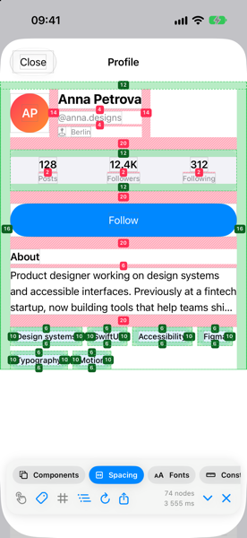
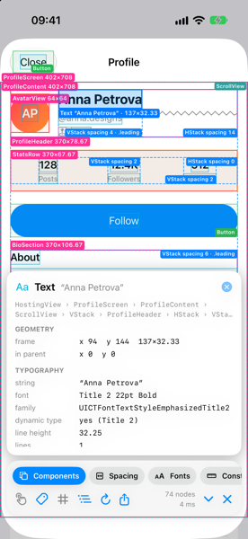
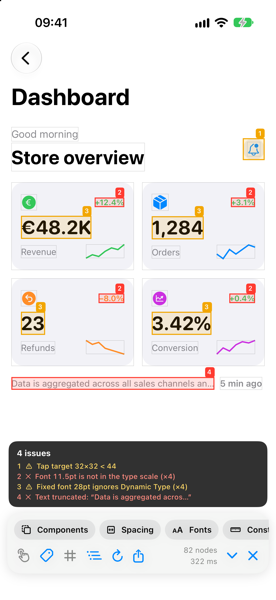
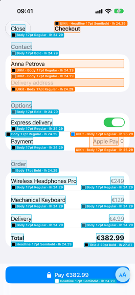

# SwiftUI Layout Inspector

A runtime layout inspector for SwiftUI screens. Attach one modifier to a screen and see what SwiftUI actually
laid out: component bounds and sizes, measured paddings and gaps (including the real default spacing),
fonts and line heights, `.frame` / `fixedSize` / `layoutPriority`, Auto Layout of embedded UIKit views,
design-rule violations and distances between elements.

The inspected view is not changed. The overlay and the controls live in a separate window above the app,
and the data comes from the SwiftUI runtime — the same debug graph Xcode's view debugger reads.

<table>
  <tr>
    <td></td>
    <td></td>
    <td></td>
    <td></td>
    <td></td>
  </tr>
  <tr>
    <td>Spacing, sheet</td>
    <td>Tap → details</td>
    <td>Lint, push</td>
    <td>Fonts, full screen, collapsed controls</td>
    <td><code>LayoutInspectorSettings</code></td>
  </tr>
</table>

## Requirements

- iOS 17+. On macOS the package compiles and does nothing, so shared code can keep its modifiers.
- Xcode 26+ (Swift tools 6.2).
- Debug builds only — see [Private API](#private-api).

## Installation

```swift
// Package.swift
.package(url: "https://github.com/adurymanov/SwiftUILayoutInspector.git", from: "0.1.0"),

.target(name: "App", dependencies: [
    .product(name: "LayoutInspector", package: "SwiftUILayoutInspector"),
]),
```

In Xcode: *File → Add Package Dependencies…* with the same URL. The repository is private, so Xcode / git
need access to it (a GitHub account in Xcode settings or an SSH key).

## Quick start

1. Enable recording of the SwiftUI debug graph once, before the first view is created:

   ```swift
   import LayoutInspector

   @main struct MyApp: App {
       init() {
           LayoutInspector.bootstrap()
       }
       var body: some Scene { WindowGroup { RootView() } }
   }
   ```

   Without it the inspector still works, but only sees the UIKit render tree (no component names, no
   paddings or fonts). Setting `SWIFTUI_VIEW_DEBUG=27` in the scheme does the same.

2. Attach the inspector to a screen:

   ```swift
   ProfileScreen()
       .layoutInspector(.spacing)
   ```

The overlay covers exactly that view and follows it: scrolling, data loading, navigation and sheet
transitions. It works the same for pushed screens, sheets and full-screen covers. Taps go to the screen
unless tap selection is on.

## Configuration

Everything the inspector shows is described by one value, `LayoutInspector.Configuration`:

| property | default | |
|---|---|---|
| `isEnabled` | `true` | `false` — no overlay, no window, no capturing |
| `mode` | `.components` | which overlay to draw, see [Modes](#modes) |
| `showsLabels` | `true` | names, sizes and values next to the outlines |
| `showsGrid`, `gridSize` | `false`, `8` | square grid over the view |
| `toolbar` | `.expanded` | `.expanded` panel, `.collapsed` corner button, `.hidden` |
| `selectsOnTap` | `false` | taps select elements and open their details instead of reaching the screen (always on in `.measure`) |
| `autoRefresh` | `true` | re-capture when the content changes; scrolling is followed either way |
| `lintRules` | see below | design rules checked in `.lint` |

It is `Codable`, `Hashable` and `Sendable`: keep it in your own state and persist it however you persist
settings. Unknown or missing keys fall back to defaults when decoding.

### Three ways to attach

```swift
// Fixed mode, optionally switched on and off.
ScreenView()
    .layoutInspector(.typography, isEnabled: showsLayout)

// A configuration value. Changes made from the inspector's toolbar stay local
// and are replaced when the value changes.
ScreenView()
    .layoutInspector(LayoutInspector.Configuration(mode: .lint, toolbar: .collapsed))

// A binding: change it to reconfigure the inspector at runtime; switching the mode,
// toggling labels or closing the inspector from its toolbar writes back.
@State private var inspector = LayoutInspector.Configuration(mode: .spacing)

ScreenView()
    .layoutInspector($inspector)
```

Toggling `isEnabled` keeps the identity of the inspected view, so its state is never reset.

### Settings rows

`LayoutInspectorSettings` edits a configuration. Put it into your own `Form` or `List`, next to the other
settings of the screen you are about to open:

```swift
Form {
    Section("Layout") {
        LayoutInspectorSettings($inspector)
    }
}
```

### Lint rules

```swift
var configuration = LayoutInspector.Configuration(mode: .lint)
configuration.lintRules = LayoutInspector.LintRules(
    grid: 4,                                  // paddings and spacings must be multiples of 4
    typeScale: [12, 14, 16, 20, 24, 32],      // allowed fixed font sizes
    warnOnFixedSizeFonts: true,               // fonts that ignore Dynamic Type
    minTapTarget: 44,                         // buttons and navigation links
    alignmentTolerance: 2                     // "almost aligned" children of leading/trailing stacks
)
```

Repeated issues (rows of a `ForEach`) are merged into one line with a counter.

## Modes

| mode | shows |
|---|---|
| `.components` | app-defined views with their type name and size, stacks (spacing, alignment), custom `Layout`s, controls, scroll views and lists |
| `.spacing` | measured paddings, gaps between stack children including the real default spacing (`8 auto`), system list insets, `UIStackView` spacing |
| `.typography` | text style or fixed font, size, weight, line height, line count, color, baseline; truncated text in red; UIKit labels and text fields too |
| `.constraints` | `.frame` (fixed, min/max/ideal, `∞` as arrows), `fixedSize`, `layoutPriority`, `aspectRatio`, spacers, stack alignment guides, Auto Layout of UIKit views |
| `.uikit` | the render tree: views and layers SwiftUI draws into, UIKit fonts and constraints |
| `.lint` | numbered design-rule violations and their list |
| `.measure` | distance between two tapped elements, or from one element to its container |

Tapping an element (with tap selection on) opens a card with its frame, position in the hierarchy, chain of
layout modifiers, typography, stack values, UIKit details and raw debug values. The toolbar also has a
searchable view tree and shares a text layout report.

## Turning it off

- **One view:** `isEnabled: false` or `configuration.isEnabled = false`. Nothing is captured or drawn.
- **The whole app:** `LayoutInspector.bootstrap(isEnabled: false)` at launch keeps SwiftUI untouched and
  makes every modifier inert; `LayoutInspector.isEnabled` switches all inspectors off and on at runtime.
- **The build:** the package trait `LayoutInspectorEngine` (enabled by default) compiles the inspector in.
  Without it every API is still there but does nothing, and the binary contains no references to private
  API:

  ```swift
  .package(url: "https://github.com/adurymanov/SwiftUILayoutInspector.git", from: "0.1.0", traits: []),
  ```

  `LayoutInspector.isAvailable` tells at runtime whether the inspector is compiled in.

Only one inspector is on screen at a time: the most recently shown one. A screen with an inspector that
presents another screen with an inspector hands over to it and takes over again when it is dismissed.
While a sheet or an alert without an inspector covers the inspected view, the inspector hides.

## Inspecting the whole window

Without touching any view — from a debug menu or a shake gesture:

```swift
LayoutInspector.show(.init(mode: .components))
LayoutInspector.hide()
LayoutInspector.isVisible
```

## Layout in tests

The same data is available without the overlay — handy for assertions that don't depend on pixels:

```swift
let layout = try await LayoutInspector.captureWhenStable(window)   // waits for data and animations

let header = try XCTUnwrap(layout.find("ProfileHeader", kind: .component))
let row = try XCTUnwrap(header.descendants(.stack).first { $0.stack?.axis == .horizontal })
XCTAssertEqual(row.measuredGaps.first, 14)
XCTAssertEqual(layout.find("Anna Petrova", kind: .text)?.font?.displayName, "Title 2 22pt Bold")
XCTAssertEqual(layout.nodes(.text).first { $0.text?.isTruncated == true }?.enclosingComponent?.title, "BioSection")
XCTAssertTrue(layout.lintIssues(rules: myRules).isEmpty)

// A stable text "layout snapshot", good for swift-snapshot-testing's `.lines`
assertSnapshot(of: layout.report(), as: .lines)

// The screen with an overlay as an image
let image = InspectorImageRenderer.image(of: window, capture: layout, options: InspectorRenderOptions(mode: .spacing))
```

`captureWhenStable` waits until nothing moves for `quietPeriod` and no `ProgressView` is visible (or until
your own `until:` condition holds) and throws `CaptureTimeoutError` otherwise. `LayoutInspector.capture(_:)`
captures immediately.

## How it works

1. **SwiftUI debug graph.** With `SWIFTUI_VIEW_DEBUG` set, every hosting view (screens, navigation
   destinations, list cells) can serialize its view tree with values: padding insets, frame constraints,
   stack spacing and alignment, resolved text attributes, positions and sizes. The inspector reads it
   through `makeViewDebugData` and turns it into a compact semantic tree.
2. **AttributeGraph.** The debug graph drops app-defined views that SwiftUI builds as view lists (most views
   inside stacks) and custom `Layout`s. They are restored from AttributeGraph's tree elements by matching
   the chain of types their `body` resolves to.
3. **UIKit render tree.** Layers SwiftUI draws into, UIKit controls, `UIViewRepresentable`s with their Auto
   Layout constraints. Works without any setup.

Captures are cached per hosting view and repeated when the render tree changes and settles. The first
capture of new content in a fresh process takes about a second (up to a few seconds for a large `Form`)
while the Swift runtime warms up; later captures take milliseconds. Everything runs on the main thread.

## Private API

The inspector relies on SwiftUI and AttributeGraph internals: the `makeViewDebugData` selector,
`_viewDebugData()`, AttributeGraph's tree-element C functions (looked up with `dlsym`) and the memory layout
of `ViewGraph`. Each level degrades on its own: without AttributeGraph there are no component names, without
the debug graph only the render tree remains.

- Ship it in debug or internal builds only. For App Store builds, remove the dependency or compile the
  inspector out with `traits: []`.
- Verified on iOS 27 (Xcode 27). Other iOS versions may lose some details.
- Component matching is heuristic. `Toggle`, `TextField` and `Picker` are recognised by their UIKit parts;
  `scaleEffect` and `rotationEffect` are not taken into account.

## Example

`Example/` contains a demo app with five screens (custom components and `Layout`, lazy stacks with
skeletons, a `Form`, a grid with lint issues, `UIViewRepresentable` with Auto Layout) and the test suite:
snapshot tests of every screen in every mode, query tests and tests of the modifier.

```bash
cd Example
xcodegen      # project.yml → LayoutInspectorExample.xcodeproj (the generated project is committed too)
open LayoutInspectorExample.xcodeproj

# open a screen right away:
xcrun simctl launch booted dev.layoutinspector.example \
  -screen profile -inspector spacing -presentation sheet -toolbar collapsed
#   -screen        profile | feed | checkout | dashboard | promo
#   -inspector     components | spacing | typography | constraints | uikit | lint | measure
#   -presentation  push | sheet | fullScreen
#   -toolbar       expanded | collapsed | hidden
#   -select "Anna Petrova"   select an element once the data is loaded
#   -window                  inspect the whole window instead

# tests (snapshots were recorded on an iPhone 17 Pro simulator, iOS 27):
TEST_RUNNER_SNAPSHOT_TESTING_RECORD=never xcodebuild test -project LayoutInspectorExample.xcodeproj \
  -scheme InspectorDemo -destination 'platform=iOS Simulator,name=iPhone 17 Pro' -collect-test-diagnostics never
```

Package unit tests run on macOS with `swift test`.
